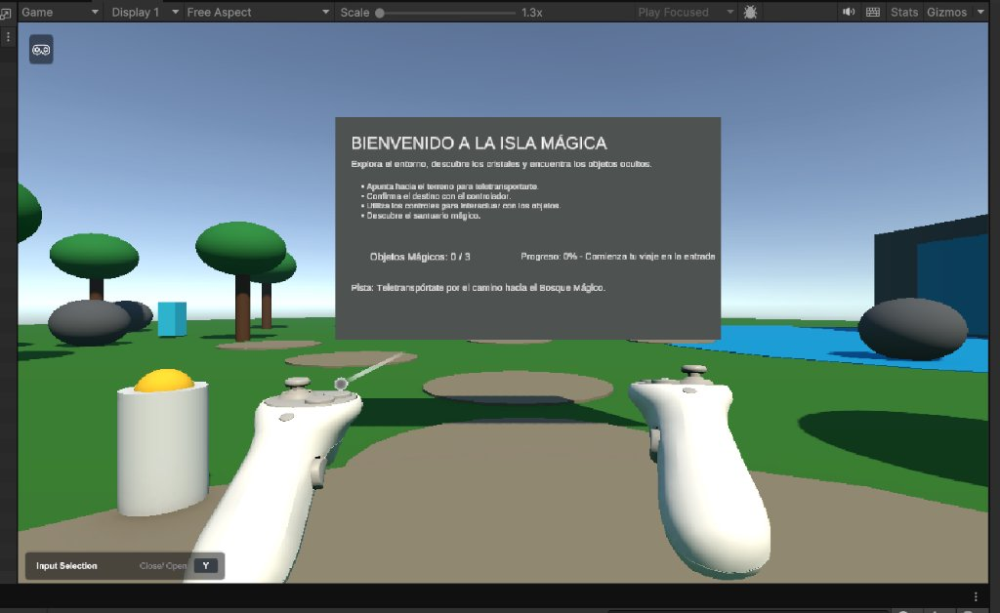
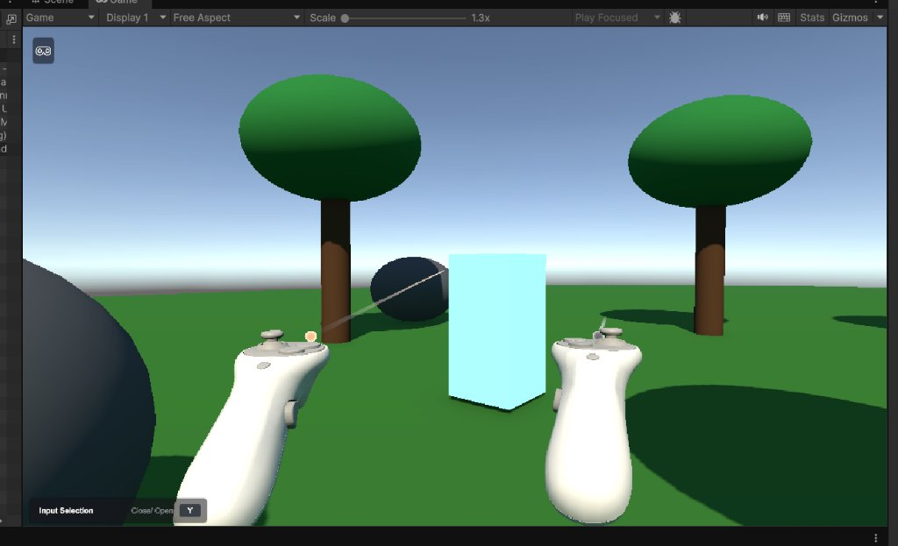
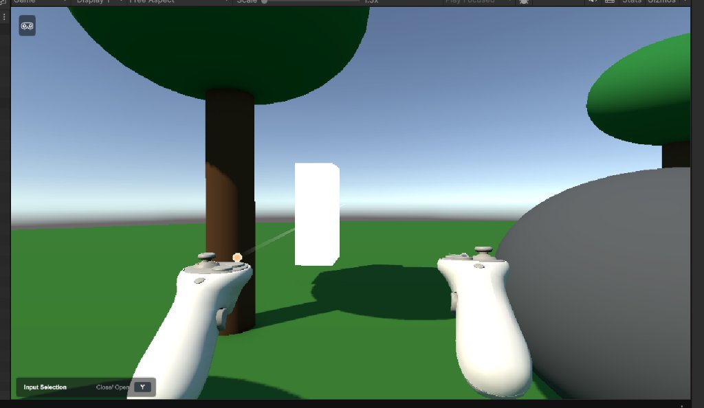
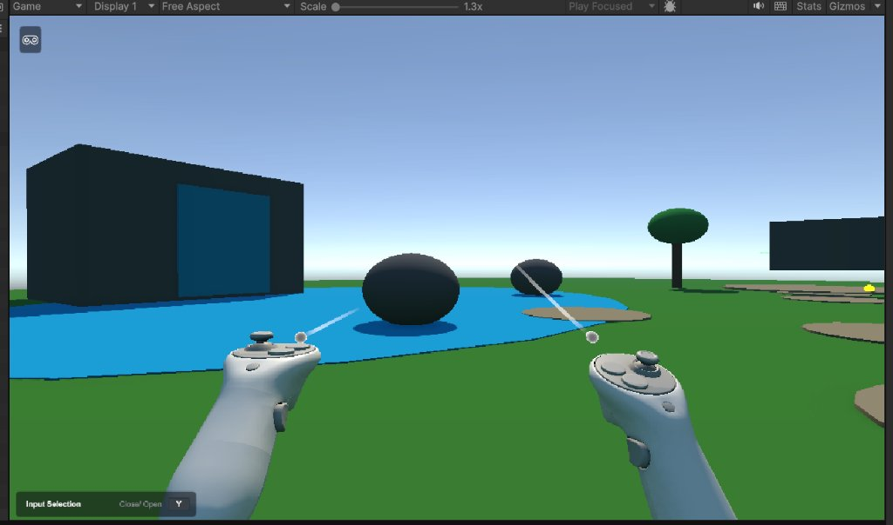
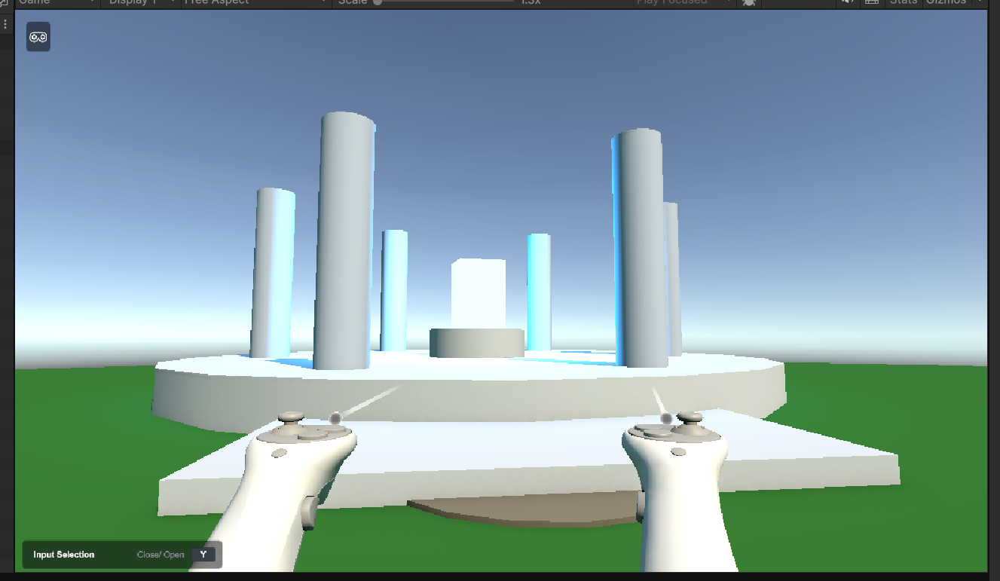

# VR Explorer: Magical Island

Immersive Virtual Reality interactive experience developed in **Unity 6 (6000.6.8f1)** using **OpenXR**, **Universal Render Pipeline (URP 17.6.0)**, and **XR Interaction Toolkit 3.6.1**.

The player explores a mythical island divided into 4 unique zones, discovers arcane crystals, awakens ancient runestones, interacts with magical relics, and unleashes the latent power of the Great Sanctuary.

> 🇪🇸 **Versión en Español:** Puedes leer la documentación en español en [README_ES.md](README_ES.md).

---

## 1. In-Game Evidence Gallery

The following real-time screenshots from **Unity 6** demonstrate the environment, VR interactors, locomotion mechanics, and interactive elements:

### Zone 1: Entrance, Welcome Board & Collectible Pedestal
First-person view from the starting platform. Showcases the World Space UI billboard, teletransport instructions, real-time collection counter, and the marble pedestal on the left with the **Golden Solar Orb**.



---

### Zone 2 (Interaction 1): Activated Sylvan Crystal
Shows the user pointing the controller ray at the forest sylvan crystal, triggering high-emission cyan illumination and energy reaction.



---

### Zone 2 (Interaction 2): Levitating Ancient Runestone
Shows the ancient runestone after selection: it rises smoothly from the ground, maintaining a continuous levitation loop and bright radiant emission.



---

### Zone 3: Magic Lake, Waterfall & Boundary Rocks
Shows the translucent water basin utilizing URP materials, the rocky cliff with a waterfall, and perimeter rocks preventing the user from teleporting into hazardous deep water.



---

### Zone 4 (Interaction 4): Great Magic Sanctuary Awakened
Shows the activation of the Sanctuary core: selecting the central crystal unleashes a radiant beam, a turquoise altar halo, and all 6 surrounding marble pillars illuminate simultaneously.



---

## 2. Technical Specifications

- **Game Engine:** Unity Editor 6000.6.8f1 (Unity 6).
- **Render Pipeline:** Universal Render Pipeline (URP 17.6.0).
- **XR Framework:** XR Interaction Toolkit 3.6.1 & XR Core Utils 2.6.0.
- **XR Plugin Management:** 4.7.0.
- **VR Backend / Runtime:** OpenXR Plugin 1.18.0.
- **Input System:** Unity Input System 1.20.1 with Action-Based Controllers.
- **User Interface:** UGUI 2.6.0 & TextMesh Pro.

---

## 3. 3D Environment & Island Zones

The island environment is constructed with optimized URP lit materials, mystical daylighting, and balanced performance:

1. **Zone 1: Island Entrance:**
   * Circular starting platform with designated teleportation area.
   * Large physical welcome sign with World Space Canvas.
   * Marble pedestal holding the first collectible item (Solar Orb).
2. **Zone 2: Magic Forest:**
   * Stylized trees with differentiated bark and canopy foliage.
   * Ancient boulders and glowing bioluminescent mushrooms.
   * Ambient floating magical spores particle system.
   * **Interaction 1:** Sylvan Crystal (color shift & audio).
   * **Interaction 2:** Ancient Runestone (levitation & rotation).
3. **Zone 3: Magic Lake:**
   * Translucent water basin with URP depth reflections.
   * Cliffside waterfall with spray splash effects.
   * Non-traversable rock perimeter preventing accidental falls.
4. **Zone 4: Magic Sanctuary:**
   * Elevated stone base with traversable arcane marble stairs.
   * 6 runic pillars with responsive light emitters.
   * Floating orbiting stones.
   * Central altar holding the **Great Sanctuary Crystal (Interaction 4)**.

---

## 4. Locomotion & Anti-Motion Sickness Comfort System

Locomotion design strictly complies with VR accessibility and motion sickness mitigation standards:

- **Mechanism:** Instant parabolic ray teleportation (`TeleportationArea`).
- **Reticle:** Visual ground marker signaling valid and invalid landing spots.
- **Orientation:** Head orientation preservation upon landing (`MatchOrientation.WorldSpaceUp`).
- **Turning:** Discrete 45° Snap Turn to eliminate smooth rotation-induced dizziness.
- **Continuous Locomotion:** Disabled by default to prioritize comfort.
- **Vignetting:** Integrated `TunnelingVignette` for visual peripheral dimming during rapid turns.

---

## 5. Interaction Systems (4 Distinct Interactions)

1. **Magical Crystals (`CrystalInteraction.cs`):**
   * Ray/far selection trigger.
   * Instant color transition with HDR emissive material, point light activation, 3D spatial audio, and UI prompt feed update.
2. **Ancient Runestone (`MagicStoneInteraction.cs`):**
   * Upon ray selection, runic etchings ignite in radiant purple.
   * Triggers a smooth levitation sequence and continuous gentle rotation.
   * Emits magical dust and sound effects.
3. **Collectible Relic (`CollectibleItem.cs` & `CollectibleManager.cs`):**
   * Configured with `XRGrabInteractable` and `Rigidbody` physics.
   * Grabbed using controller grip button.
   * Triggers a golden flash pulse, play audio, and updates the global collection progress counter `(X / 3)`.
4. **Sanctuary Awakening (`SanctuaryController.cs`):**
   * Interacting with the Great Central Crystal triggers a multi-stage energy surge.
   * Central light column fires up, all 6 surrounding pillars light up, magical particle bursts trigger, and the main UI board proclaims: **"ISLAND EXPLORATION COMPLETED!"**.

---

## 6. User Interface (World Space UI)

The user interface is embedded directly into the 3D environment (`VRUIController.cs`) on a rustic stone billboard:
- **Title:** "BIENVENIDO A LA ISLA MÁGICA / WELCOME".
- **Mission brief:** Exploration goals.
- **Controls guide:** Clear teleport and interaction mappings.
- **Live Counter:** Magic objects gathered `(0/3, 1/3, 2/3, 3/3)`.
- **Progress indicator:** Textual percentage completion.
- **Dynamic notification feed:** Real-time feedback for every triggered event.

---

## 7. Project Structure

```
Assets/
  Scenes/
    MainVRScene.unity         <-- MAIN EVALUATION SCENE
    SampleScene.unity
  Scripts/
    VRSetupManager.cs         <-- Runtime VR rig & comfort setup
    TeleportManager.cs        <-- Teleport areas & ground bounds
    CrystalInteraction.cs     <-- Interaction 1 (Crystals)
    MagicStoneInteraction.cs  <-- Interaction 2 (Runestone)
    CollectibleManager.cs     <-- Score & collection progress
    CollectibleItem.cs        <-- Interaction 3 (Grab interactable)
    SanctuaryController.cs    <-- Interaction 4 (Sanctuary core)
    VRUIController.cs         <-- UI world canvas controller
  Materials/
    Environment/              <-- Grass, Paths, Rocks, Marble, Leaves
    Magical/                  <-- Blue/Gold crystals, Runes, Shrooms
    Water/                    <-- M_MagicalWater
  Editor/
    CreateVRScene.cs          <-- Tools > VR Explorer > Generate Main Scene
  Audio/
    Button Pop.wav            <-- 3D Interaction audio
Screenshots/
  01_Bienvenida_UI_Definitiva.jpg
  02_Cristal_Silvano_Interaccion1.jpg
  03_Piedra_Runica_Levitando.jpg
  04_Lago_Cascada_Definitiva.jpg
  06_Santuario_Despertado_Interaccion4.jpg
```

---

## 8. How to Run & Test

### For Evaluators:

1. **Open the project in Unity Editor 6000.6.8f1 (Unity 6).**
2. In the **Project** window, navigate to:
   `Assets/Scenes/MainVRScene.unity` and double-click to open.
3. To regenerate the scene programmatically at any time:
   Go to menu **Tools > VR Explorer > Generate Main Scene**.
4. Connect a VR headset (Meta Quest 2/3/Pro, HTC Vive, Valve Index, or OpenXR headset) via Link, AirLink, or SteamVR.
5. Press **Play (▶)** in Unity Editor.

### VR Controls:
- **Teleport:** Point the joystick/trigger at grass or pathway; release to teleport.
- **Interact / Activate:** Point controller ray at crystals or runestones and pull Trigger or Grip.
- **Grab Collectible:** Bring hand close to the orb on the pedestal and press Grip.
- **Snap Turn:** Flick the right joystick left or right for 45° discrete turns.

---

## 9. Hardware & Testing Compatibility

- **Supported Headsets:** Meta Quest 2 / 3 / Pro (via Quest Link, AirLink, Virtual Desktop), HTC Vive, Valve Index, Windows Mixed Reality.
- **Editor Testing without Headset:** Fully supports **XR Device Simulator / XR Interaction Simulator** (preconfigured in the project). Press Play in the Unity Editor to simulate hands and head using keyboard and mouse.
