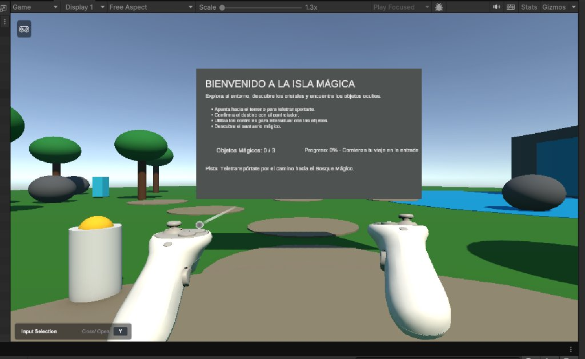
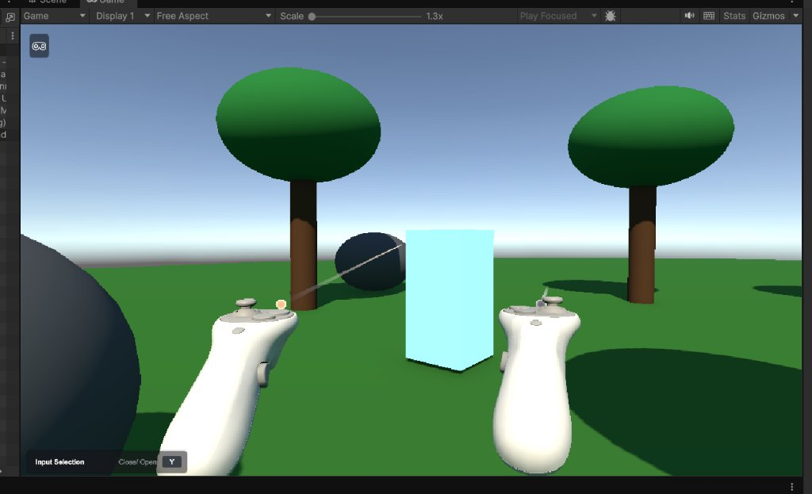
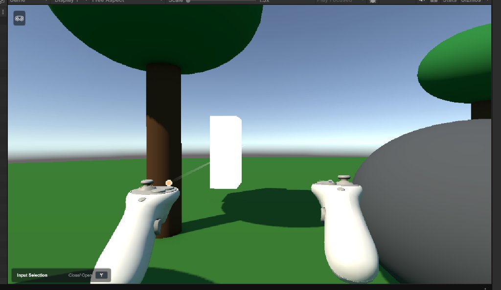
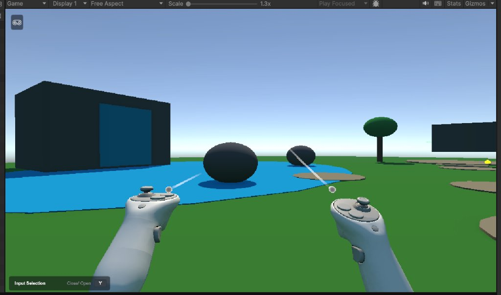
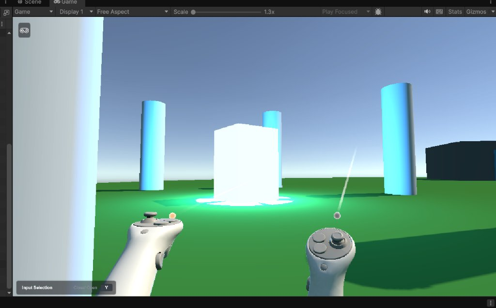

# VR Explorer: Magical Island

Experiencia interactiva de Realidad Virtual inmersiva desarrollada en **Unity 6 (6000.6.8f1)** utilizando **OpenXR**, **Universal Render Pipeline (URP 17.6.0)** y **XR Interaction Toolkit 3.6.1**.

El usuario explora una isla mística compuesta por 4 zonas diferenciadas, descubre cristales arcanos, activa runas ancestrales, interactúa con reliquias mágicas y despierta el poder latente del gran Santuario Insular.

---

## 1. Galería de Evidencias de la Experiencia (In-Game)

Las siguientes capturas documentan la ejecución en tiempo real en **Unity 6** demostrando el funcionamiento de cada zona, interactores VR y mecánicas:

### Zona 1: Entrada, Cartel de Bienvenida y Pedestal Coleccionable
Vista en primera persona desde la plataforma inicial. Se aprecia el cartel con la UI en World Space, instrucciones de teletransporte, contador de progreso en tiempo real y el pedestal a la izquierda con el **Orbe Solar dorado**.



---

### Zona 2 (Interacción 1): Cristal Silvano Activado
Muestra al usuario apuntando con el rayo del controlador al cristal silvano del bosque, desencadenando su iluminación cian/celeste brillante y reacción de energía.



---

### Zona 2 (Interacción 2): Piedra Mágica Rúnica Levitando
Muestra la piedra rúnica tras ser seleccionada con el mando VR: se eleva despegándose del suelo y mantiene su animación de flotación continua y brillo blanco radiante.



---

### Zona 3: Lago Mágico, Cascada y Delimitación Perimetral
Muestra la cuenca de agua azul translúcida con materiales URP, el peñasco con la cascada y las rocas de contorno que protegen al usuario impidiendo teletransportarse al agua profunda.



---

### Zona 4 (Interacción 4): Gran Santuario Mágico Despertado
Muestra la activación del núcleo del Santuario: al seleccionar el gran cristal central, este desata una emisión de luz radiante con halo turquesa en el altar y los 6 pilares de mármol se iluminan en respuesta.



---

## 2. Características Técnicas del Proyecto

- **Motor de Videojuegos:** Unity Editor 6000.6.8f1 (Unity 6).
- **Pipeline de Renderizado:** Universal Render Pipeline (URP) versión 17.6.0.
- **Framework XR:** XR Interaction Toolkit 3.6.1 & XR Core Utils 2.6.0.
- **XR Plugin Management:** 4.7.0.
- **Proveedor VR:** OpenXR Plugin 1.18.0.
- **Sistema de Entrada:** Unity Input System 1.20.1 con Action-Based Controllers.
- **Interfaz y Tipografía:** UGUI 2.6.0 & TextMesh Pro.

---

## 3. Entorno 3D y Zonas de la Isla

La escena principal está construida con materiales lit optimizados para URP, iluminación diurna mística y un balance de performance/inmersión:

1. **Zona 1: Entrada de la Isla:**
   * Plataforma inicial circular con área de teletransporte.
   * Gran cartel físico de bienvenida con Canvas integrado en World Space.
   * Pedestal de mármol con el primer coleccionable (Orbe Solar).
2. **Zona 2: Bosque Mágico:**
   * Vegetación estilizada con troncos y follaje diferenciado.
   * Rocas milenarias y hongos bioluminiscentes.
   * Sistema de esporas ambientales flotantes.
   * **Interacción 1:** Cristal Silvano interactivo.
   * **Interacción 2:** Piedra Rúnica ancestral con levitación física.
3. **Zona 3: Lago Mágico:**
   * Gran cuenca de agua con material translúcido y reflexiones URP.
   * Cascada mágica con peñasco y partículas de salpicadura.
   * Borde perimetral delimitado por formaciones rocosas no transitables.
4. **Zona 4: Santuario Mágico:**
   * Basamento elevado con escalinatas de mármol arcano transitables.
   * 6 pilares rúnicos con fuentes de luz que reaccionan a la activación.
   * Piedras mágicas flotantes en órbita perpetua.
   * Altar central con el **Gran Cristal del Santuario (Interacción 4)**.

---

## 4. Sistema de Navegación y Confort Anti-Náuseas

El diseño de locomoción prioriza estrictamente la prevención de la cinetosis (VR sickness):

- **Mecanismo:** Teletransporte instantáneo por parábola/rayo (`TeleportationArea`).
- **Retícula:** Indicador visual en el suelo que señala destino válido/bloqueado.
- **Orientación:** Conservación de la orientación de la cabeza del usuario tras el salto (`MatchOrientation.WorldSpaceUp`).
- **Giros:** Snap Turn discreto configurado a 45° para evitar rotaciones suaves continuas generadoras de mareo.
- **Locomoción Continua:** Desactivada por diseño ergonómico para garantizar confort.
- **Vignette:** Integración del sistema `TunnelingVignette` para atenuación de bordes visuales.

---

## 5. Sistema de Interacciones (4 Interacciones Implementadas)

1. **Cristales Mágicos (`CrystalInteraction.cs`):**
   * Activación por rayo/selección a distancia.
   * Cambio inmediato de coloración con material emisivo HDR, encendido de luz puntual, sonido posicional 3D y actualización de mensaje en pantalla.
2. **Piedra Mágica Rúnica (`MagicStoneInteraction.cs`):**
   * Al ser seleccionada, las runas despiertan en tono púrpura radiante.
   * Reproduce una suave animación física de elevación (levitación) y rotación continua.
   * Emite polvo mágico y audio místico.
3. **Objeto Coleccionable (`CollectibleItem.cs` & `CollectibleManager.cs`):**
   * Configurado con `XRGrabInteractable` y física `Rigidbody`.
   * El usuario puede tomar el objeto físicamente con cualquiera de los mandos VR.
   * Al levantarlo, genera destello dorado, pulso de escala, reproduce sonido de éxito y actualiza el contador de progreso global `(X / 3)`.
4. **Despertar del Santuario (`SanctuaryController.cs`):**
   * Al interactuar con el Gran Cristal Central, se produce una reacción en cadena.
   * Se enciende el haz de luz cenital, se iluminan los 6 pilares rúnicos circundantes, se detonan ráfagas de partículas místicas y se proclama en el cartel principal el mensaje de **"¡EXPLORACIÓN DE LA ISLA COMPLETADA CON ÉXITO!"**.

---

## 6. Interfaz de Usuario (UI en World Space)

La interfaz se encuentra incrustada en el entorno 3D (`VRUIController.cs`) mediante un Canvas World Space montado sobre un cartel de piedra y madera:
- **Título:** "BIENVENIDO A LA ISLA MÁGICA".
- **Descripción:** Objetivos de la experiencia.
- **Instrucciones claras:** Navegación por teletransporte y botones de interacción.
- **Contador en tiempo real:** Objetos mágicos recolectados `(0/3, 1/3, 2/3, 3/3)`.
- **Barra de Progreso textual:** Porcentaje de completitud.
- **Área de Notificaciones Dinámicas:** Informa qué cristal, piedra o reliquia se acaba de accionar.

---

## 7. Estructura de Archivos

```
Assets/
  Scenes/
    MainVRScene.unity         <-- ESCENA PRINCIPAL
    SampleScene.unity
  Scripts/
    VRSetupManager.cs         <-- Validación de confort y rig VR en runtime
    TeleportManager.cs        <-- Configuración y áreas de teletransporte
    CrystalInteraction.cs     <-- Interacción 1 (Cristales)
    MagicStoneInteraction.cs  <-- Interacción 2 (Piedra rúnica)
    CollectibleManager.cs     <-- Gestor de progreso y conteo
    CollectibleItem.cs        <-- Interacción 3 (Objetos agarrables)
    SanctuaryController.cs    <-- Interacción 4 (Santuario central)
    VRUIController.cs         <-- Controlador de textos y notificaciones UI
  Materials/
    Environment/              <-- Césped, Caminos, Rocas, Mármol, Follaje
    Magical/                  <-- Cristales azul y oro, Runas, Hongos
    Water/                    <-- M_MagicalWater
  Editor/
    CreateVRScene.cs          <-- Menú Tools > VR Explorer > Generate Main Scene
  Audio/
    Button Pop.wav            <-- Audio de interacción 3D
Screenshots/
  01_Bienvenida_UI_Definitiva.jpg
  02_Cristal_Silvano_Interaccion1.jpg
  03_Piedra_Runica_Levitando.jpg
  04_Lago_Cascada_Definitiva.jpg
  06_Santuario_Despertado_Interaccion4.jpg
```

---

## 8. Instrucciones de Ejecución y Apertura

### Para Evaluadores y Docentes:

1. **Abrir el proyecto en Unity Editor 6000.6.8f1 (Unity 6).**
2. En la ventana **Project**, navegar a:
   `Assets/Scenes/MainVRScene.unity` y hacer doble clic para abrir la escena.
3. Si en algún momento se desea regenerar la escena de forma limpia y automática, se puede presionar en el menú superior:
   **Tools > VR Explorer > Generate Main Scene**.
4. Conectar el visor VR (Meta Quest, Oculus Rift, HTC Vive o compatible con OpenXR) vía cable Link o AirLink / SteamVR.
5. Presionar el botón **Play (▶)** en Unity Editor.

### Controles en VR:
- **Teletransporte:** Mover el stick o presionar gatillo apuntando a los senderos o césped; soltar o confirmar para teletransportarse.
- **Interactuar / Activar Cristales:** Apuntar el rayo del mando derecho/izquierdo hacia los cristales o la runa y presionar el botón de selección (Trigger o Grip).
- **Recoger Coleccionable:** Acercar la mano al orbe sobre el pedestal y presionar el botón de agarre (Grip) para levantarlo.
- **Giro Cómodo:** Mover el stick derecho hacia los lados para realizar Snap Turn de 45°.

---

## 9. Hardware Recomendado y Pruebas

- **Dispositivos VR Compatibles:** Meta Quest 2 / 3 / Pro (vía Quest Link o Virtual Desktop / OpenXR), HTC Vive, Valve Index, Windows Mixed Reality.
- **Pruebas en Editor sin Casco:** El proyecto soporta **XR Device Simulator / XR Interaction Simulator** (importado y configurado automáticamente en el proyecto), permitiendo simular las manos y la cabeza mediante ratón y teclado pulsando Play en el Editor.
- **Prueba Física Real:** Requiere conectar un visor con OpenXR Runtime habilitado (Oculus OpenXR o SteamVR OpenXR).
